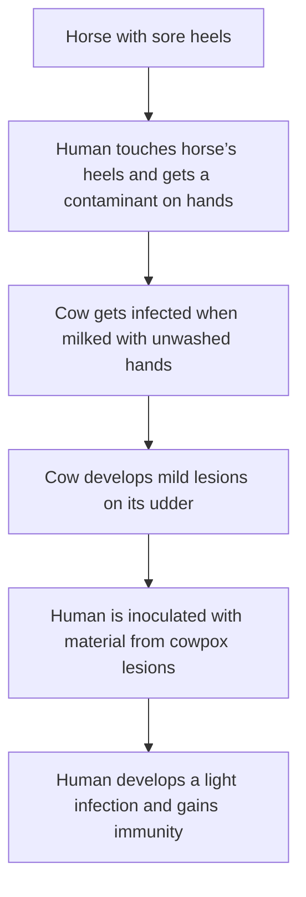

> In science credit goes to the man who convinces the world, not the man to whom the idea first occurs.

\-Francis Galton

Edward Jenner is considered the “Father of Immunology” for his work with both cowpox and smallpox. While inoculations were known and used before him, Jenner made the case that he could create immunity to smallpox by inoculating people with cowpox due to the similarities present in both symptoms of disease. These inoculations entailed taking the pus from the infected scabs of people suffering cowpox, cutting open the skin of a healthy subject with a lancet, and spreading this impure material into the wound. If they were to develop disease and recover, they would then be considered immune to smallpox. This would then be tested by the same method of inoculation but made up of the pus from those considered to be smallpox cases.

Jenner presented a mini booklet outlining numerous cases detailing this process. I highlighted a few of these cases below but I want to provide a little background on Jenner first before sharing excerpts from his report:

## **Edward Jenner and the History of Smallpox and vaccination**

“Edward Jenner is well known around the world for his innovative contribution to immunization and the ultimate eradication of smallpox ([2](https://www.ncbi.nlm.nih.gov/labs/pmc/articles/PMC1200696/#B2)). **Jenner’s work is widely regarded as the foundation of immunology—despite the fact that he was neither the first to suggest that infection with cowpox conferred specific immunity to smallpox nor the first to attempt cowpox inoculation for this purpose.”**

“While Jenner’s interest in the protective effects of cowpox began during his apprenticeship with George Harwicke, it was 1796 before he made the first step in the long process whereby smallpox, the scourge of mankind, would be totally eradicated. For many years, he had heard the tales that dairymaids were protected from smallpox naturally after having suffered from cowpox. **Pondering this, Jenner concluded that cowpox not only protected against smallpox but also could be transmitted from one person to another as a deliberate mechanism of protection.** In May 1796, Edward Jenner found a young dairymaid, Sarah Nelms, who had fresh cowpox lesions on her hands and arms*.* On May 14, 1796, using matter from Nelms’ lesions, he inoculated an 8-year-old boy, James Phipps. Subsequently, the boy developed mild fever and discomfort in the axillae. Nine days after the procedure he felt cold and had lost his appetite, but on the next day he was much better. In July 1796, Jenner inoculated the boy again, this time with matter from a fresh smallpox lesion. No disease developed, and Jenner concluded that protection was complete ([10](https://www.ncbi.nlm.nih.gov/labs/pmc/articles/PMC1200696/#B10)).

In 1797, Jenner sent a short communication to the Royal Society describing his experiment and observations. **However, the paper was rejected.** Then in 1798, having added a few more cases to his initial experiment, Jenner privately published a small booklet entitled *An Inquiry into the Causes and Effects of the Variolae Vaccinae, a disease discovered in some of the western counties of England, particularly Gloucestershire and Known by the Name of Cow Pox* ([18](https://www.ncbi.nlm.nih.gov/labs/pmc/articles/PMC1200696/#B18), [10](https://www.ncbi.nlm.nih.gov/labs/pmc/articles/PMC1200696/#B10)). The Latin word for cow is *vacca*, and cowpox is *vaccinia*; Jenner decided to call this new procedure *vaccination*. The 1798 publication had three parts. **In the first part Jenner presented his view regarding the origin of cowpox as a disease of horses transmitted to cows. The theory was discredited during Jenner’s lifetime.** He then presented the hypothesis that infection with cowpox protects against subsequent infection with smallpox. The second part contained the critical observations relevant to testing the hypothesis. The third part was a lengthy discussion, in part polemical, of the findings and a variety of issues related to smallpox. **The publication of the** ***Inquiry*** **was met with a mixed reaction in the medical community.”**

[https://www.ncbi.nlm.nih.gov/pmc/articles/PMC1200696/](https://www.ncbi.nlm.nih.gov/pmc/articles/PMC1200696/)

A brief passage from the introduction by the site presenting Jenner’s papers included this interesting snippet:

> “Jenner’s first paper on his discovery was never printed; but in 1798 appeared the first of the following treatises. **Its reception by the medical profession was highly discouraging;** but progress began when Cline, the surgeon of St. Thomas’s Hospital, used the treatment with success. Jenner continued his investigations, publishing his results from time to time, and gradually gaining recognition; **though opposition to his theory and practise was at first vehement, and has never entirely disappeared.”**

Jenner’s original theory hinged on his conviction that cowpox came from the sore heels of horses. He believed that men who attended the sick horses acquired the “virus” on their hands after working on them. If they were to subsequently milk cows afterwards, this transmitted the “virus” to the cows and ultimately to humans. This defining aspect of Jenner’s theory was discredited during his lifetime. There are many other reasons to discredit his observations when looking at his report, including the assumption that a “virus” existed to begin with. This is a lengthy paper so bear with me. There are cases I edited out due to length considerations so if you want more details on Jenner’s experiments, I highly recommend reading the whole report. Highlights and a summary below:

## **VACCINATION AGAINST SMALLPOX**

**AN INQUIRY INTO THE CAUSES AND EFFECTS OF THE VARIOLE VACCINE, OR COW-POX. 1798**

“The deviation of man from the stage in which he was originally placed by nature seems to have proved to him a prolific source of diseases. From the love of splendour, from the indulgences of luxury, and from his fondness for amusement **he has familiarised himself with a great number of animals, which may not originally have been intended for his associates.**

The wolf, disarmed of ferocity, is now pillowed in the lady’s lap. \[Footnote: The late Mr. John Hunter proved, by experiments, that the dog is the wolf in a degenerate state.\] The cat, the little tiger of our island, whose natural home is the forest, is equally domesticated and caressed. The cow, the hog, the sheep, and the horse, are all, for a variety of purposes, brought under his care and dominion.

There is a disease to which the horse, from his state of domestication, is frequently subject. The farriers have called it the grease. **It is an inflammation and swelling in the heel, from which issues matter possessing properties of a very peculiar kind, which seems capable of generating a disease in the human body (after it has undergone the modification which I shall presently speak of), which bears so strong a resemblance to the smallpox that I think it highly probable it may be the source of the disease.**

In this dairy country a great number of cows are kept, and the office of milking is performed indiscriminately by men and maid servants. **One of the former having been appointed to apply dressings to the heels of a horse affected with the grease, and not paying due attention to cleanliness, incautiously bears his part in milking the cows, with some particles of the infectious matter adhering to his fingers. When this is the case, it commonly happens that a disease is communicated to the cows, and from the cows to the dairymaids, which spreads through the farm until the most of the cattle and domestics feel its unpleasant consequences.** This disease has obtained the name of the cow-pox. It appears on the nipples of the cows in the form of irregular pustules. **At their first appearance they are commonly of a palish blue, or rather of a colour somewhat approaching to livid, and are surrounded by an erysipelatous inflammation.** These pustules, unless a timely remedy be applied, frequently degenerate into phagedenic ulcers, which prove extremely troublesome. \[Footnote: They who attend sick cattle in this country find a speedy remedy for stopping the progress of this complaint in those applications which act chemically upon the morbid matter, such as the solutions of the vitriolum zinci and the vitriolum cupri, etc.\] The animals become indisposed, and the secretion of milk is much lessened. **Inflamed spots now begin to appear on different parts of the hands of the domestics employed in milking, and sometimes on the wrists, which quickly run on to suppuration, first assuming the appearance of the small vesications produced by a burn.** Most commonly they appear about the joints of the fingers and at their extremities; but whatever parts are affected, if the situation will admit, these superficial suppurations put on a circular form, with their edges more elevated than their centre, **and of a colour distantly approaching to blue.** Absorption takes place, and tumours appear in each axilla. The system becomes affected–the pulse is quickened; and shiverings, succeeded by heat, with general lassitude and pains about the loins and limbs, with vomiting, come on. The head is painful, and the patient is now and then even affected with delirium. These symptoms, varying in their degrees of violence, generally continue from one day to three or four, **leaving ulcerated sores about the hands,** which, from the sensibility of the parts, are very troublesome, and commonly heal slowly, frequently becoming phagedenic, like those from whence they sprung. The lips, nostrils, eyelids, and other parts of the body are sometimes affected with sores; **but these evidently arise from their being heedlessly rubbed or scratched with the patient’s infected fingers.** No eruptions on the skin have followed the decline of the feverish symptoms in any instance that has come under my inspection, one only excepted, and in this case a very few appeared on the arms: they were very minute, of a vivid red colour, and soon died away without advancing to maturation; so that I cannot determine whether they had any connection with the preceding symptoms.

Thus the disease makes its progress from the horse **\[Footnote: Jenner’s conclusion that “grease” and cow-pox were the same disease has since been proved erroneous;** but this error has not invalidated his main conclusion as to the relation of cow-pox and smallpox.–EDITOR.\] to the nipple of the cow, and from the cow to the human subject

**Morbid matter of various kinds, when absorbed into the system, may produce effects in some degree similar;** but what renders the cow-pox virus so extremely singular is that the person who has been thus affected is forever after secure from the infection of the smallpox; neither exposure to the variolous effluvia, nor the insertion of the matter into the skin, producing this distemper.

In support of so extraordinary a fact, I shall lay before my reader a great number of instances. \[Footnote: **It is necessary to observe that pustulous sores frequently appear spontaneously on the nipples of cows, and instances have occurred, though very rarely, of the hands of the servants employed in milking being affected with sores in consequence, and even of their feeling an indisposition from absorption. These pustules arc of a much milder nature than those which arise from that contagion which constitutes the true cow-pox. They are always free from the bluish or livid tint so conspicuous in the pustules in that disease.** No erysipelas attends them, nor do they shew any phagedenic disposition as in the other case, but quickly terminate in a scab without creating any apparent disorder in the cow. This complaint appears at various seasons of the year, but most commonly in the spring, when the cows are first taken from their winter food and fed with grass. It is very apt to appear also when they are suckling their young. **But this disease is not to be considered as similar in any respect to that of which I am treating, as it is incapable of producing any specific effects on the human constitution.** However, it is of the greatest consequence to point it out here, lest the want of discrimination should occasion an idea of security from the infection of the smallpox, which might prove delusive.\]”

“CASE IV.–Mary Barge, of Woodford, in this parish, was inoculated with variolous matter in the year 1791. **An efflorescence of a palish red colour soon appeared about the parts where the matter was inserted, and spread itself rather extensively,** but died away in a few days without producing any variolous symptoms. **\[Footnote: It is remarkable that variolous matter, when the system is disposed to reject it, should excite inflammation on the part to which it is applied more speedily than when it produces the smallpox. Indeed, it becomes almost a criterion by which we can determine whether the infection will be received or not. It seems as if a change, which endures through life, had been produced in the action, or disposition to action, in the vessels of the skin; and it is remarkable, too, that whether this change has been effected by the smallpox or the cow-pox that the disposition to sudden cuticular inflammation is the same on the application of variolous matter.\]** She has since been repeatedly employed as a nurse to smallpox patients, without experiencing any ill consequences. This woman had the cow-pox when she lived in the service of a farmer in this parish thirty-one years before.”

“CASE VII.–Although the preceding history pretty clearly evinces that the constitution is far less susceptible of the contagion of the cow-pox after it has felt that of the smallpox, and although in general, as I have observed, **they who have had the smallpox, and are employed in milking cows which are infected with the cow-pox,** **either escape the disorder, or have sores on the hands without feeling any general indisposition,** yet the animal economy is subject to some variation in this respect, which the following relation will point out:

In the summer of the year 1796 the cow-pox appeared at the farm of Mr. Andrews, a considerable dairy adjoining to the town of Berkeley. It was communicated, as in the preceding instance, by an infected cow purchased at a fair in the neighbourhood. **The family consisted of the farmer, his wife, two sons, a man and a maid servant; all of whom, except the farmer (who was fearful of the consequences), bore a part in milking the cows. The whole of them, exclusive of the man servant, had regularly gone through the smallpox; but in this case no one who milked the cows escaped the contagion. All of them had sores upon their hands, and some degree of general indisposition, preceded by pains and tumours in the axillas:** but there was no comparison in the severity of the disease as it was felt by the servant man, who had escaped the smallpox, and by those of the family who had not, for, while he was confined to his bed, they were able, without much inconvenience, to follow their ordinary business.”

“CASE IX.–Although the cow-pox shields the constitution from the smallpox, and the smallpox proves a protection against its own future poison, **yet it appears that the human body is again and again susceptible of the infectious matter of the cow-pox,** as the following history will demonstrate.

William Smith, of Pyrton in this parish, contracted this disease when he lived with a neighbouring farmer in the year 1780. **One of the horses belonging to the farm had sore heels, and it fell to his lot to attend him. By these means the infection was carried to the cows, and from the cows it was communicated to Smith.** On one of his hands were several ulcerated sores, and he was affected with such symptoms as have been before described.

**In the year 1791 the cow-pox broke out at another farm where he then lived as a servant, and he became affected with it a second time; and in the year 1794 he was so unfortunate as to catch it again.** The disease was equally as severe the second and third time as it was on the first. \[Footnote: This is not the case in general–a second attack is commonly very slight, and so, I am informed, it is among the cows.\]”

“CASE XIII.–**One instance has occurred to me of the system being affected from the matter issuing from the heels of horses,** and of its remaining afterwards unsusceptible of the variolous contagion; another, where the smallpox appeared obscurely; and a third, in which its complete existence was positively ascertained.

First, Thomas Pearce is the son of a smith and farrier near to this place. **He never had the cow-pox; but, in consequence of dressing horses with sore heels at his father’s, when a lad, he had sores on his fingers which suppurated, and which occasioned a pretty severe indisposition.** Six years afterwards I inserted variolous matter into his arm repeatedly, without being able to produce any thing more than slight inflammation, which appeared very soon after the matter was applied, **and afterwards I exposed him to the contagion of the smallpox with as little effect.** \[Footnote: **It is a remarkable fact, and well known to many, that we are frequently foiled in our endeavours to communicate the smallpox by inoculation to blacksmiths, who in the country are farriers. They often, as in the above instance, either resist the contagion entirely, or have the disease anomalously.** Shall we not be able to account for this on a rational principle?\]

CASE XIV.–**Secondly, Mr. James Cole, a farmer in this parish, had a disease from the same source as related in the preceding case,** and some years after was inoculated with variolous matter. He had a little pain in the axilla and felt a slight indisposition for three or four hours. A few eruptions shewed themselves on the forehead, **but they very soon disappeared without advancing to maturation.**

CASE XV.–Although in the former instances the system seemed to be secured, or nearly so, from variolous infection, by the absorption of matter from the sores produced by the diseased heels of horses, **yet the following case decisively proves that this cannot be entirely relied upon until a disease has been generated by the morbid matter from the horse on the nipple of the cow, and passed through that medium to the human subject.**

**Mr. Abraham Riddiford, a farmer at Stone in this parish, in consequence of dressing a mare that had sore heels, was affected with very painful sores in both his hands, tumours in each axilla, and severe and general indisposition.** **A surgeon in the neighbourhood attended him, who knowing the similarity between the appearance of the sores upon his hands and those produced by the cow-pox, and being acquainted also with the effects of that disease on the human constitution, assured him that he never need to fear the infection of the smallpox; but this assertion proved fallacious, for, on being exposed to the infection upwards of twenty years afterwards, he caught the disease, which took its regular course in a very mild way.** There certainly was a difference perceptible, although it is not easy to describe it, in the general appearance of the pustules from that which we commonly see. Other practitioners who visited the patient at my request agreed with me in this point, though there was no room left for suspicion as to the reality of the disease, as I inoculated some of his family from the pustules, who had the smallpox, with its usual appearances, in consequence.”

“CASE XVII.–The more accurately to observe the progress of the infection I selected a healthy boy, about eight years old, for the purpose of inoculation for the cow-pox. **The matter was taken from a sore on the hand of a dairymaid \[Footnote: From the sore on the hand of Sarah Nelmes. See the preceding case.\], who was infected by her master’s cows, and it was inserted, on the 14th of May, 1796, into the arm of the boy by means of two superficial incisions,** barely penetrating the cutis, each about half an inch long.

On the seventh day he complained of uneasiness in the axilla, and on the ninth he became a little chilly, lost his appetite, and had a slight headache. During the whole of this day he was perceptibly indisposed, and spent the night with some degree of restlessness, **but on the day following he was perfectly well.**

**The appearance of the incisions in their progress to a state of maturation were much the same as when produced in a similar manner by variolous matter.** The only difference which I perceived was in the state of the limpid fluid arising from the action of the virus, which assumed rather a darker hue, and in that of the efflorescence spreading round the incisions, which had more of an erysipelatous look than we commonly perceive when variolous matter has been made use of in the same manner; but the whole died away (leaving on the inoculated parts scabs and subsequent eschars) without giving me or my patient the least trouble.

**In order to ascertain whether the boy, after feeling so slight an affection of the system from the cow–pox virus, was secure from the contagion of the smallpox, he was inoculated the 1st of July following with variolous matter, immediately taken from a pustule. Several slight punctures and incisions were made on both his arms, and the matter was carefully inserted, but no disease followed.** The same appearances were observable on the arms as we commonly see when a patient has had variolous matter applied, after having either the cow–pox or smallpox. Several months afterwards he was again inoculated with variolous matter, but no sensible effect was produced on the constitution.”

“A mare, the property of a person who keeps a dairy in a neighbouring parish, began to have sore heels the latter end of the month of February, 1798, which were occasionally washed by the servant men of the farm, **Thomas Virgoe, William Wherret, and William Haynes, who in consequence became affected with sores in their hands, followed by inflamed lymphatic glands in the arms and axillae, shiverings succeeded by heat, lassitude, and general pains in the limbs.** A single paroxysm terminated the disease; for within twenty–four hours they were free from general indisposition, nothing remaining but the sores on their hands. **Haynes and Virgoe, who had gone through the smallpox from inoculation, described their feelings as very similar to those which affected them on sickening with that malady.** Wherret never had had the smallpox. Haynes was daily employed as one of the milkers at the farm, and the disease began to shew itself among the cows about ten days after he first assisted in washing the mare’s heels. Their nipples became sore in the usual way, with bluish pustules; but as remedies were early applied, they did not ulcerate to any extent.

CASE XVIII.–John Baker, a child of five years old, was inoculated March 16, 1798, **with matter taken from a pustule on the hand of Thomas Virgoe, one of the servants who had been infected from the mare’s heels.** He became ill on the sixth day with symptoms similar to those excited by cow–pox matter. On the eighth day he was free from indisposition.

There was some variation in the appearance of the pustule on the arm. **Although it somewhat resembled a smallpox pustule, yet its similitude was not so conspicuous as when excited by matter from the nipple of the cow, or when the matter has passed from thence through the medium of the human subject.**

This experiment was made to ascertain the progress and subsequent effects of the disease when thus propagated. We have seen that the virus from the horse, when it proves infectious to the human subject, is not to be relied upon as rendering the system secure from variolous infection, but that the matter produced by it upon the nipple of the cow is perfectly so. **Whether its passing from the horse through the human constitution, as in the present instance, will produce a similar effect, remains to be decided.** This would mow have been effected, but the boy was rendered unit for inoculation from having felt the effects of a contagious fever in a workhouse soon after this experiment was made.

CASE XX.-From William Summers the disease was transferred to William Pead, a boy of eight years old, who was inoculated March 28th. On the sixth day he complained of pain in the axilla, **and on the seventh was affected with the common symptoms of a patient sickening with the smallpox from inoculation,** which did not terminate till the third day after the seizure. **So perfect was the similarity to the variolous fever that I was induced to examine the skin, conceiving there might have been some eruptions, but none appeared.** **The efflorescent blush around the part punctured in the boy’s arm was so truly characteristic of that which appears on variolous inoculation that I have given a representation of it.** The drawing was made when the pustule was beginning to die away and the areola retiring from the centre.

CASE XXI.-April 5th: Several children and adults were inoculated from the arm of William Pead. The greater part of them sickened on the sixth day, and were well on the seventh, **but in three of the number a secondary indisposition arose in consequence of an extensive erysipelatous inflammation which appeared on the inoculated arms.** It seemed to arise from the state of the pustule, which spread out, accompanied with some degree of pain, to about half the diameter of a sixpence. One of these patients was an infant of half a year old. By the application of mercurial ointment to the inflamed parts (a treatment recommended under similar circumstances in the inoculated smallpox) the complaint subsided without giving much trouble.

Hannah Excel, an healthy girl of seven years old, and one of the patients above mentioned, **received the infection from the insertion of the virus under the cuticle of the arm in three distinct points. The pustules which arose in consequence so much resembled, on the twelfth day, those appearing from the infection of variolous matter, that an experienced inoculator would scarcely have discovered a shade of difference at that period.** Experience now tells me that almost the only variation which follows consists in the pustulous fluids remaining limpid nearly to the time of its total disappearance; and not, as in the direct smallpox, becoming purulent.”

**“After the many fruitless attempts to give the smallpox to those who had had the cow-pox, it did not appear necessary, nor was it convenient to me, to inoculate the whole of those who had been the subjects of these late trials;** yet I thought it right to see the effects of variolous matter on some of them, particularly William Summers, the first of these patients who had been infected with matter taken from the cow. **He was, therefore, inoculated with variolous matter from a fresh pustule; but, as in the preceding cases, the system did not feel the effects of it in the smallest degree.** I had an opportunity also of having this boy and William Pead inoculated by my nephew, Mr. Henry Jenner, whose report to me is as follows: “I have inoculated Pead and Barge, two of the boys whom you lately infected with the cow-pox. On the second day the incisions were inflamed and there was a pale inflammatory stain around them. On the third day these appearances were still increasing and their arms itched considerably. On the fourth day the inflammation was evidently subsiding, and on the sixth day it was scarcely perceptible. No symptom of indisposition followed.

**“To convince myself that the variolous matter made use of was in a perfect state I at the same time inoculated a patient with some of it who never had gone through the cow-pox, and it produced the smallpox in the usual regular manner.”**

**These experiments afforded me much satisfaction; they proved that the matter, in passing from one human subject to another, through five gradations, lost none of its original properties,** J. Barge being the fifth who received the infection successively from William Summers, the boy to whom it was communicated from the cow.”

**“Although I presume it may be unnecessary to produce further testimony in support of my assertion “that the cow–pox protects the human constitution from the infection of the smallpox,”** yet it affords me considerable satisfaction to say that Lord Somerville, the President of the Board of Agriculture, to whom this paper was shewn by Sir Joseph Banks, has found upon inquiry that the statements were confirmed by the concurring testimony of Mr. Dolland, a surgeon, who resides in a dairy country remote from this, in which these observations were made. **With respect to the opinion adduced “that the source of the infection is a peculiar morbid matter arising in the horse,” although I have not been able to prove it from actual experiments conducted immediately under my own eye, yet the evidence I have adduced appears sufficient to establish it.**

They who are not in the habit of conducting experiments may not be aware of the coincidence of circumstances necessary for their being managed so as to prove perfectly decisive; nor how often men engaged in professional pursuits are liable to interruptions which disappoint them almost at the instant of their being accomplished: however, I feel no room for hesitation respecting the common origin of the disease, **being well convinced that it never appears among the cows (except it can be traced to a cow introduced among the general herd which has been previously infected, or to an infected servant) unless they have been milked by some one who, at the same time, has the care of a horse affected with diseased heels.**

The spring of the year 1797, which I intended particularly to have devoted to the completion of this investigation, proved, from its dryness, remarkably adverse to my wishes;-for it frequently happens, while the farmers’ horses are exposed to the cold rains which fall at that season, **that their heels become diseased, and no cow-pox then appeared in the neighbourhood.**

**The active quality of the virus from the horses’ heels is greatly increased after it has acted on the nipples of the cow, as it rarely happens that the horse affects his dresser with sores, and as rarely that a milkmaid escapes the infection when she milks infected cows.** It is most active at the commencement of the disease, even before it has acquired a pus-like appearance; indeed, I am not confident whether this property in the matter does not entirely cease as soon as it is secreted in the form of pus. I am induced to think it does cease \[Footnote: It is very easy to procure pus from old sores on the heels of horses. This I have often inserted into scratches made with a lancet, on the sound nipples of cows, and have seen no other effects from it than simple inflammation.\], and that it is the thin, darkish- looking fluid only, oozing from the newly-formed cracks in the heels, similar to what sometimes appears from erysipelatous blisters, which gives the disease. **Nor am I certain that the nipples of the cows are at all times in a state to receive the infection.** The appearance of the disease in the spring and the early part of the summer, when they are disposed to be affected with spontaneous eruptions so much more frequently than at other seasons, **induces me to think that the virus from the horse must be received upon them when they are in this state,** in order to produce effects: experiments, however, must determine these points. **But it is clear that when the cow-pox virus is once generated, that the cows cannot resist the contagion, in whatever state their nipples may chance to be, if they are milked with an infected hand.**

**Whether the matter, either from the cow or the horse, will affect the sound skin of the human body, I cannot positively determine; probably it will not, unless on those parts where the cuticle is extremely thin, as on the lips, for example.** I have known an instance of a poor girl who produced an ulceration on her lip by frequently holding her finger to her mouth to cool the raging of a cow-pox sore by blowing upon it. **The hands of the farmers’ servants here, from the nature of their employments, are constantly exposed to those injuries which occasion abrasions of the cuticle, to punctures from thorns, and such like accidents; so that they are always in a state to feel the consequence of exposure to infectious matter.”**

**“Elizabeth Wynne, who had the cow-pox in the year 1759, was inoculated with variolous matter, without effect, in the year 1797, and again caught the cow-pox in the year 1798.** When I saw her, which was on the eighth day after she received the infection, I found her affected with general lassitude, shiverings, alternating with heat, coldness of the extremities, and a quick and irregular pulse. These symptoms were preceded by a pain in the axilla. On her hand was one large pustulous sore, which resembled that delineated in Plate No. I. (Plate appears in original.)

It is curious also to observe that the virus, which with respect to its effects is undetermined and uncertain previously to its passing from the horse through the medium of the cow, should then not only become more active, **but should invariably and completely possess those specific properties which induce in the human constitution symptoms similar to those of the variolous fever,** and effect in it that peculiar change which for ever renders it unsusceptible of the variolous contagion.

**May it not then be reasonably conjectured that the source of the smallpox is morbid matter of a peculiar kind, generated by a disease in the horse, and that accidental circumstances may have again and again arisen, still working new changes upon it until it has acquired the contagious and malignant form under which we now commonly see it making its devastations amongst us?** And, from a consideration of the change which the infectious matter undergoes from producing a disease on the cow, **may we not conceive that many contagious diseases, now prevalent among us, may owe their present appearance not to a simple, but to a compound, origin? For example, is it difficult to imagine that the measles, the scarlet fever, and the ulcerous sore throat with a spotted skin have all sprung from the same source, assuming some variety in their forms according to the nature of their new combinations? The same question will apply respecting the origin of many other contagious diseases which bear a strong analogy to each other.**

**There are certainly more forms than one, without considering the common variation between the confluent and distinct, in which the smallpox appears in what is called the natural way.** About seven years ago a species of smallpox spread through many of the towns and villages of this part of Gloucestershire: **it was of so mild a nature that a fatal instance was scarcely ever heard of, and consequently so little dreaded by the lower orders of the community that they scrupled not to hold the same intercourse with each other as if no infectious disease had been present among them.** I never saw nor heard of an instance of its being confluent. The most accurate manner, perhaps, in which I can convey an idea of it is by saying that had fifty individuals been taken promiscuously and infected by exposure to this contagion, **they would have had as mild and light a disease as if they had been inoculated with variolous matter in the usual way.** The harmless manner in which it shewed itself could not arise from any peculiarity either in the season or the weather, for I watched its progress upwards of a year without perceiving any variation in its general appearance. **I consider it then as a variety of the smallpox.”**

“A medical gentleman (now no more), who for many years inoculated in this neighbourhood, **frequently preserved the variolous matter intended for his use on a piece of lint or cotton, which, in its fluid state, was put into a vial, corked, and conveyed into a warm pocket; a situation certainly favourable for speedily producing putrefaction in it.** In this state (not unfrequently after it had been taken several days from the pustules) it was inserted into the arms of his patients, and brought on inflammation of the incised parts, swellings of the axillary glands, fever, and sometimes eruptions. **But what was this disease? Certainly not the smallpox; for the matter having from putrefaction lost or suffered a derangement in its specific properties, was no longer capable of producing that malady, those who had been inoculated in this manner being as much subject to the contagion of the smallpox as if they had never been under the influence of this artificial disease; and many, unfortunately, fell victims to it, who thought themselves in perfect security.** **The same unfortunate circumstance of giving a disease, supposed to be the smallpox, with inefficacious variolous matter, having occurred under the direction of some other practitioners within my knowledge, and probably from the same incautious method of securing the variolous matter,** I avail myself of this opportunity of mentioning what I conceive to be of great importance; and, as a further cautionary hint, I shall again digress so far as to add another observation on the subject of inoculation.

**Whether it be yet ascertained by experiment that the quantity of variolous matter inserted into the skin makes any difference with respect to the subsequent mildness or violence of the disease, I know not; but I have the strongest reason for supposing that if either the punctures or incisions be made so deep as to go through it and wound the adipose membrane, that the risk of bringing on a violent disease is greatly increased.** I have known an inoculator whose practice was “to cut deep enough (to use his own expression) to see a bit of fat.” and there to lodge the matter. **The great number of bad cases, independent of inflammations and abscesses on the arms, and the fatality which attended this practice, was almost inconceivable;** and I cannot account for it on any other principle than that of the matter being placed in this situation instead of the skin.”

I do not mean to insinuate that exposure to cool air, and suffering the patient to drink cold water when hot and thirsty, may not moderate the eruptive symptoms and lessen the number of pustules; yet, to repeat my former observation, I cannot account for the uninterrupted success, or nearly so, of one practitioner, and the wretched state of the patients under the care of another, where, in both instances, **the general treatment did not differ essentially, without conceiving it to arise from the different modes of inserting the matter for the purpose of producing the disease.** As it is not the identical matter inserted which is absorbed into the constitution, but that which is, by some peculiar process in the animal economy, generated by it, is it not probable that different parts of the human body may prepare or modify the virus differently? Although the skin, for example, adipose membrane, or mucous membranes are all capable of producing the variolous virus by the stimulus given by the particles originally deposited upon them, yet I am induced to conceive that each of these parts is capable of producing some variation in the qualities of the matter previous to its affecting the constitution. **What else can constitute the difference between the smallpox when communicated casually or in what has been termed the natural way, or when brought on artificially through the medium of the skin?**

After all, are the variolous particles, possessing their true specific and contagious principles, ever taken up and conveyed by the lymphatics unchanged into the blood vessels? I imagine not. **Were this the case, should we not find the blood sufficiently loaded with them in some stages of the smallpox to communicate the disease by inserting it under the cuticle, or by spreading it on the surface of an ulcer? Yet experiments have determined the impracticability of its being given in this way;** although it has been proved that variolous matter, when much diluted with water and applied to the skin in the usual manner, will produce the disease. But it would be digressing beyond a proper boundary to go minutely into this subject here.”

“Its rise in this country may not have been of very remote date, as the practice of milking cows might formerly have been in the hands of women only; which I believe is the case now in some other dairy countries, and, consequently, that the cows might not in former times have been exposed to the contagious matter brought by the men servants from the heels of horses. **\[Footnote: I have been informed from respectable authority that in Ireland, although dairies abound in many parts of the island, the disease is entirely unknown. The reason seems obvious. The business of the dairy is conducted by women only. Were the meanest vassal among the men employed there as a milker at a dairy, he would feel his situation unpleasant beyond all endurance.\]** Indeed, a knowledge of the source of the infection is new in the minds of most of the farmers in this neighbourhood, but it has at length produced good consequences; and it seems probable, from the precautions they are now disposed to adopt, that the appearance of the cow-pox here may either be entirely extinguished or become extremely rare.

Should it be asked whether this investigation is a matter of mere curiosity, or whether it tends to any beneficial purpose, I should answer that, notwithstanding the happy effects of inoculation, with all the improvements which the practice has received since its first introduction into this country, **it not very unfrequently produces deformity of the skin, and sometimes, under the best management, proves fatal.”**

“Several instances have come under my observation which justify the assertion **that the disease cannot be propagated by effluvia.** The first boy whom I inoculated with the matter of cow-pox slept in a bed, while the experiment was going forward, **with two children who never had gone through either that disease or the smallpox, without infecting either of them.**

A young woman who had the cow-pox to a great extent, several sores which maturated having appeared on the hands and wrists, **slept in the same bed with a fellow-dairymaid who never had been infected with either the cow-pox or the smallpox, but no indisposition followed.**

Another instance has occurred of a young woman on whose hands were several large suppurations from the cow-pox, **who was at the same time a daily nurse to an infant, but the complaint was not communicated to the child.**

**In some other points of view the inoculation of this disease appears preferable to the variolous inoculation.”**

**“There are many who, from some peculiarity in the habit, resist the common effects of variolous matter inserted into the skin,** and who are in consequence haunted through life with the distressing idea of being insecure from subsequent infection.”

[https://biotech.law.lsu.edu/cphl/history/articles/jenner.htm#paperI](https://biotech.law.lsu.edu/cphl/history/articles/jenner.htm#paperI)

## **In Summary:**

- Jenner began by insinuating that **because man has domesticated animals,** he has brought disease unto himself
- He believed that the **morbid pustule from the sore heels of horses** infected cows after the men who worked on the horses milked the cows without washing their hands
- The cows had **palish blue markings** (*bruises perhaps?*) along the nipples with inflammation and decreased milk production
- The workers had **small burn markings on their hands** (*friction burns perhaps?*)
- Jenner’s (*discredited*) theory was the “virus” **went from horse** to the nipples of cows to humans
- He stated that morbid matter of many kinds absorbed into the system **can produce similar symptoms of disease**
- Jenner admitted that there is a similar yet milder form of the disease affecting cows and sometimes humans **but did not consider it cowpox** because the pustules were not blue snd humans were only sometimes aflicted
- He spoke of a girl, Mary, whom he inoculated and **the procedure produced red inflammation** at the spot that spread extensively
- Jenner considered that this reaction was a sign of the body rejecting the “virus”
- He claimed that those have had the smallpox, and who are employed in milking cows which are infected with cowpox, either escape the disorder, **or have sores on the hands** without feeling any general indisposition (*thus, they do not escape the disorder…*)
- Jenner described a case where a family, which consisted of the farmer, his wife, two sons, a man and a maid servant; all of whom, except the farmer (who was fearful of the consequences), **bore a part in milking the cows** supposedly infected with cowpox
- The whole family, exclusive of the man servant, **had regularly gone through smallpox; but in this case no one who milked the cows escaped the contagion**
- **All of them had sores upon their hands,** and some degree of general indisposition, preceded by pains and tumours in the axillas
- *In other words, even those who had smallpox come down with cowpox*
- He claimed that although cowpox shields from smallpox, and smallpox proves a protection against its own future poison, **it appeared that the human body is again and again susceptible to the infectious matter of cowpox**
- In 1780, one of the horses belonging to a farm **had sore heels,** and it fell to a man named William Smith to attend the horse; **it was by these means the infection was carried to the cows, and from the cows it was communicated to Smith** (*which later turned out to be a false conclusion…*)
- William Smith came down with the same disease in 1791 and 1794
- Jenner next attempted to make the connection between the “virus” being **passed from horse to cow to man**
1. Thomas Pearce, who never had cowpox, acquired lesions from the heels of horses, however Jenner could not produce smalpox in him through inoculation
2. James Cole became sick from the same horse source but only a few pustules were produced on his forehead after inoculation
3. Abraham Riddiford was affected with very painful sores in both his hands, tumours in each axilla, and severe and general indisposition after dressing a mare that had sore heels
- He was told by a surgeon that attended him, **who knowing the similarity between the appearance of the sores upon his hands and those produced by the cowpox,** assured him that he never need to fear the infection of smallpox; but this was false as he caught smallpox 20 years later
- Jenner felt the final case decisively proved that the disease passing from horse to man could not be entirely relied upon **until a disease had been generated by the morbid matter from the horse on the nipple of the cow, and passed through that medium to the human subject**
- He admits that **it is a well-known fact that Blacksmiths can not be given smallpox through inoculation** although he theorized some may have it “anomalously”
- Jenner presented the case of an 8-year-old boy **inoculated in 2 spots with the pus from a dairy maid said to have cowpox** and the boy suffered very mild headache, chilliness, and restlessness on the 9th night but was better by the next day
- The boy was later **inoculated with pus from smallpox** but this did not produce disease thus Jenner concluded the boy was now immune to it
- Three servent men on a farm washed the sore heels of a mare and **developed lesions on their hands** which was said to be passed to cows who were milked by them
- Two of the men **who had smalpox from inoculations** said it felt similar
- A 5-year-old boy was inoculated with pustule from the hand of a man and developed cowpox-like symptoms 6 days later
- Another 8-year-old boy was inoculated with cowpox and had fever/symptoms **identical to that caused by smallpox inoculation**
- A number of adults and children were inoculated and **3 of them developed secondary infections from the inoculation**
- A 7-year-old girl was inoculated in 3 places and developed symptoms **identical to those acquired from smallpox inoculation**
- Jenner stated there were **many fruitless attempts** to give the smallpox to those who had had the cowpox
- Jenner claimed he was satisfied after sickening many **people by “passing” pustule from one human to another through 5 gradations** without the pustule losing potency
- He then presumed that it was unnecessary to produce further testimony in support of his assertion **“that the cow-pox protects the human constitution from the infection of the smallpox”**
- Jenner was convinced that the morbid matter **from horses** was the cause of both cowpox/smallpox **even though he admitted he could not prove it experimentally**
- He was well convinced that cowpox never appeared in cows **unless they had been milked by some one who, at the same time, had cared for a horse affected with diseased heels**
- In 1797, even though many horses had diseased heels, **no cows came down with cowpox** and Jenner could not conclude his investigation that year
- Jenner was convinced cows could not escape cowpox **if they were milked by hands who had worked on diseased horse heels**
- He believed that the pustule from diseased horses/cows **could not cause disease on healthy human skin**, only if the hands were already sore/cut from hard labor
- Jenner shared the case of a woman who had cowpox in 1759, was inoculated with smallpox in 1797, and again had cowpox in 1798
- He pondered why the “virus” should invariably and completely possess those specific properties **which induce in the human constitution symptoms similar to those of the variolous fever**
- Jenner thought it conceivable that many contagious diseases may owe their present appearance not to a simple **but to a compound origin through animals**
- He questioned whether it was difficult to imagine that the measles, the scarlet fever, and the ulcerous sore throat with a spotted skin **all sprang from the same source**
- The same question applied to the origin of many other contagious diseases **which bear a strong analogy to each other**
- Jenner believed there were various versions of smallpox as 7 years before his investigation, **there was an outbreak so mild no one was concerned nor took precautions and had symptoms as light as those caused by inoculation**
- He discussed cases where smallpox pustule by a Dr. was stored in such a way that **those inoculated with it succumbed to severe disease and even death**
- Jenner concluded it **must have been a different disease other than smallpox** due to his assumption that the putrification process “killing” the “virus”
- He knew of **“artificial” cases of smallpox caused by inoculation** but he stated the material used was “non-infectious” thus it was not real smallpox
- Jenner **did not know** whether or not the amount of smallpox pustule inoculated into a subject caused worsening disease
- He believed that deeper cuts down to the fat layers for inoculations **caused inconceivable deaths in many cases**
- Jenner pondered what caused differences between the natural smallpox **and that created through artificial means of inoculation**
- He stated that smallpox **could not be induced through blood experimentally**
- Jenner knew in Ireland, **cowpox was unheard** of even though they had dairy farms
- He presumed it was because women were the ones milking the cows **instead of angry men**
- Jenner admitted that his inoculations cause **skin deformities and death**
- He presented many cases were cowpox **could not be spread from person-to-person**
- He admitted that in some other points of view, **the inoculation of this disease appears preferable to the variolous inoculation**
- Jenner admitted there are many **who are not successfully inoculated with smallpox**

Edward Jenner, through his unethical and crude experiments, proved that taking diseased pustule and spreading it into the wounds in healthy subjects could cause disease in some but not in others. He based his work on the assumption that a “virus” was present in the pustules. While he made observations about the unsanitary conditions and the need for unwashed hands with open sores in order to become “infected,” he clung to an invisible “virus” as the culprit even while stating morbid material of many kinds, once introduced into the human system, can produce the same symptoms of disease. This unproven idea of creating immunity by vaccinating against an unseen foe with dead/diseased material still persists today.

While Jenner’s theory that the “virus” was transferred from the sore heels of horses to the udders of cows and into the hands of man was ultimately discredited, his biggest mistake was assuming a “virus” to begin with. At no point in time did Jenner ever purify and isolate a “virus” from pustule or moribund material. He only assumed one was winin the material he obtained. He never once considered that the blisters on the udders of cows and the hands of men and milkmaid  were caused by the friction created from the act of milking the cows, even though he knew that open sores on hands after milking led to symptoms. In Ireland, there were dairy farms which never came down with cases of cowpox to which Jenner ascribed to women being the milkmaid versus angry men, thus implying a gentler touch not leading to friction burns.

Jenner also seemed to gloss over any contradictory findings, such as the fact that there were instances were the symptoms of smallpox could be shown to occur after a person had cowpox even though he believed cowpox conferred immunity to smallpox. He could not produce any disease using blood and he believed that the size, depth, and method of the cut during inoculation had a profound impact on the success of vaccination. In the instance of one physician Jenner knew, the inoculation produced symptoms so severe and deadly that Jenner would not claim it as smallpox but stated it was either a new disease or “virus” that had produced the deadly reaction. In cases where inoculation produced the same symptoms as smallpox, Jenner claimed it was “artificial” smallpox. Jenner also seemingly believed that in order to escape the fate of smallpox,, all one had to do was become a Blacksmith as they were unable to catch the disease.

If one reads Jenners writings with an open mind and a critical eye, it is obvious why he was cast aside by many in the medical community. His methods were crude and disgusting and resulted in lifetime scarring and even death. He created a fictional narrative about an invisible pathogen leaping from horse to cow to man. Jenner claimed to be able to provide immunity to a disease process he himself dreamed up using methods he had created. While many believe that Jenner’s work led to the eradication of smallpox ([it didn’t](https://viroliegy.com/2022/01/05/was-smallpox-really-eradicated/)), his legacy should rightfully be as the man who unleashed the scourge of vaccination upon us. While vaccination wasn’t Jenner’s original idea, he was the man who ultimately convinced those in power that these methods were successful. In the end, the only thing Edward Jenner was successful with was creating the most deadly vaccine known to man.

Below is a rewritten version of your note in a simpler and clearer language. I’ve organized it with headings, lists, tables, a callout, and even a simple Mermaid flowchart to help visualize the process.

--------------------------------------------------

# Edward Jenner’s Smallpox Paper (1798)

This note explains how Edward Jenner, known as the “Father of Immunology,” described his early experiments with cowpox and smallpox. Jenner’s work led to the idea that infecting a person with cowpox could protect them from smallpox. Although some of his ideas have been discredited over time, his experiments changed the way people looked at disease and immunity—even though his methods were crude.

> “In science credit goes to the man who convinces the world, not the man to whom the idea first occurs.”
> –Francis Galton

--------------------------------------------------

## Background

- Edward Jenner experimented with using cowpox to protect people from smallpox.
- He noted that dairymaids (women who milked cows) often developed a mild disease (cowpox) and then rarely caught smallpox.
- His process involved taking material from cowpox lesions and using it to infect healthy people.
- Although earlier inoculations already existed, Jenner made a strong case showing that cowpox created lasting immunity.

--------------------------------------------------

## Jenner’s Method in Plain Words

1. **Collecting Material**  
   - Jenner took the pus (infected material) from cowpox lesions.
   - Example: Imagine gently scraping a small blister on a cow’s udder.

2. **Inoculation Process**  
   - He made small cuts on a healthy person’s skin (using a lancet) and applied the material.
   - After a few days, if the person got a mild illness and then recovered, they were considered “immune” to smallpox.
   - Later, Jenner tested this immunity by trying to infect the same person with material from an actual smallpox lesion.

3. **Testing Results**  
   - In one famous case, Jenner inoculated an 8-year-old boy.  
   - The boy got a slight fever and discomfort but recovered quickly.
   - When he was later exposed to smallpox, he did not get sick.

--------------------------------------------------

Here's how the selected method differs from the systematic scientific method, along with some flaws and weaknesses:

──────────────────────────────

- # Scientific Method vs. Jenner's Method

#### Hypothesis and Prediction

   - **Scientific Method**: You begin with a clear hypothesis based on observations, then predict what will happen if that hypothesis is true.
   - **Jenner’s Method**: Although Jenner suspected that exposure to cowpox might protect against smallpox, his description shows little in the way of a formal, testable hypothesis. Instead, he relied more on a “try-it-and-see” approach without detailed predictions.

#### Experimental Design and Controls

   - **Scientific Method**: Experiments are designed with controls (e.g., placebo or untreated groups) and variables are carefully manipulated. This helps isolate the effect of the factor being tested.
   - **Jenner’s Method**: There is no clearly defined control group. For example, Jenner tested one healthy subject (an 8-year-old boy) to see if a mild reaction would grant immunity, but there wasn’t a systematic comparison with individuals who were not inoculated, or rigorous measures to rule out other factors. 

#### Repeatability and Sample Size

   - **Scientific Method**: To confirm results, experiments are repeated multiple times with a significant and diverse sample.
   - **Jenner’s Method**: Jenner’s account relies on a few case examples and anecdotal reports. This small number of tests and the lack of replication under controlled conditions weakens the ability to generalize his findings.

#### Data Analysis and Quantitative Measurement

   - **Scientific Method**: Data are systematically recorded, analyzed statistically, and experiments are often blinded to reduce bias.
   - **Jenner’s Method**: While Jenner observed outcomes (e.g., fever, discomfort, recovery), his method is largely descriptive and lacks rigorous quantitative analysis. There is no mention of measures to prevent observer bias or to ensure that the outcomes were not influenced by other unnoticed variables.

#### Ethical Considerations

   - **Scientific Method Today**: Ethical guidelines require informed consent, oversight, and minimization of harm.
   - **Jenner’s Method**: In Jenner’s time, ethical standards were not as developed. His approach—inoculating a child and repeatedly exposing them to infectious material—would be considered unethical by today’s standards. This lack of ethical framework affects both the safety of the subjects and the reliability of the data, as stress or harm could influence results.
──────────────────────────────

# Flaws and Weaknesses in Jenner’s Approach

– Lack of proper control groups leaves room for alternative explanations (e.g., the boy might have been less susceptible due to other factors).

–Small sample size means his conclusions are based on too few observations.

–No blinding or standardization, so results could be influenced by bias—Jenner’s own expectations might have affected his observations.

–Ethical issues and lack of informed consent can compromise the reliability of data and willingness of subjects, impacting experimental outcomes.

–The method is largely anecdotal rather than rigorously scientific; it relies on case histories rather than systematic, repeatable experiments.

──────────────────────────────

In summary, while Jenner’s approach was innovative for its time, it deviated from the modern scientific method by lacking formal hypothesis testing, proper controls, repeatability, rigorous data analysis, and ethical considerations. These weaknesses mean that although his observations led to a pivotal breakthrough, the method itself is not as reliable or robust as the systematic approach used in modern science.

## A Simple Process Diagram

Below is a basic Mermaid flowchart representing Jenner’s idea:

--------------------------------------------------

## Key Points with Checklists

- Jenner noticed that people who got cowpox rarely caught smallpox.
- He used cowpox as a natural vaccine by introducing material from lesions into healthy individuals.
- His experiments involved multiple cases, including children and adults.
- Even though Jenner’s theory about the “virus” moving from horses to cows to humans was later disproven, his method showed that exposure to a less dangerous disease could lead to immunity against a more dangerous one.

--------------------------------------------------

## Examples from the Experiments

- **Case of the 8-year-old Boy:**  
   - Inoculated with cowpox material from a dairymaid’s lesion.  
   - Experienced mild fever and slight discomfort for one day before recovering.  
   - Later, when inoculated with smallpox material, the boy showed no disease signs.
- **Family Exposure Example:**  
   - In one scenario on a dairy farm, all milkers (except one cautious farmer) ended up with sores on their hands after working with infected horses and cows.  
   - The appearance and severity of the sores varied, and some individuals experienced mild general illness.

--------------------------------------------------

## Critique and Legacy

> [!summary] 
> - Jenner assumed an invisible “virus” caused the disease without ever isolating or purifying it.
> - He did not consider that the lesions on the cows and humans might be due to friction or other factors (like open cuts from milking).
> - His experiments sometimes caused scarring, disfigurement, or even death.
> - Despite significant criticisms and later improvements in medical microbiology, Jenner convinced many that cowpox inoculation could protect against smallpox.
> - His work, however controversial, paved the way for future vaccination methods. 

--------------------------------------------------

## Summary Table

| Aspect                   | Simple Explanation                                                                                              |
|--------------------------|----------------------------------------------------------------------------------------------------------------|
| Inoculation Material     | Pus from cowpox lesions (collected from diseased cows or dairymaids’ hands).                                   |
| How It Was Done          | Small cuts were made on healthy skin and infected material was applied, similar to how one might apply a bandage.|
| Expected Outcome         | The person would get a mild illness and then become immune to the more dangerous smallpox.                      |
| Key Observation          | Those who got cowpox rarely got smallpox afterward.                                                            |
| Major Critique           | Jenner assumed a “virus” was responsible, never proving it; other factors (like friction burns) were ignored.   |

--------------------------------------------------

## Callout: Points to Ponder

> Although Jenner convinced many that his method worked, his understanding of disease was incomplete. Today, we recognize that his idea of a “virus” coming from one source is oversimplified, yet his work was a crucial turning point in the development of vaccines. For more details, see [[ViroLIEgy]].

--------------------------------------------------

## Enhancements for a Dynamic Note in Obsidian

- Consider linking related notes: [[Vaccination History]], [[Immunology Basics]].
- Use tags like #vaccination, #public-health, #historical-analysis.
- Add images and diagrams to remind you of the process as shown above.
- Interactive checklists can be used for further investigation or study tasks.

--------------------------------------------------

This simplified note now provides a clearer view of Edward Jenner’s work in plain language with examples, visuals, and structured sections to support learning and cross-referencing in your Obsidian vault.

| Date | Created | Modified |
|-------|----------|----------|
|2025-03-04|10|36|
