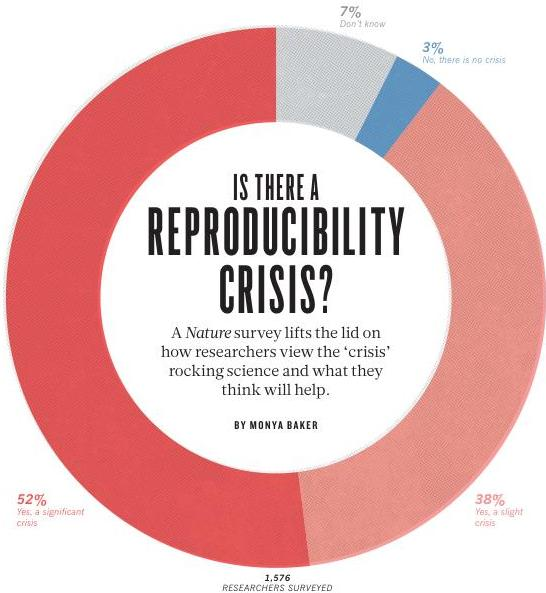
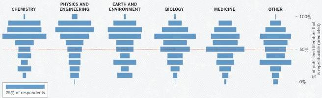
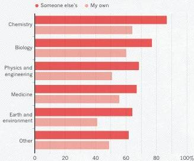
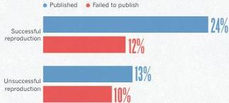
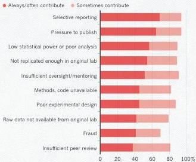
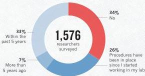

---
tags:
  - reproducibility
  - scientific-attitudes
  - survey-methods
  - published-results-trust
  - researcher-experiences
  - replication
  - replication-crisis
  - replication-failure
  - replicability
  - data-quality
---

NATURE | VOL 533 | 26 MAY 2016
© 2016 Macmillan Publishers Limited. All rights reserved.

# IS THERE A REPRODUCIBILITY CRISIS?

A Nature survey lifts the lid on how researchers view the ‘crisis’ rocking science and what they think will help.

BY MONYA BAKER

52% Yes, a significant crisis

38% Yes, a slight crisis

1,576 RESEARCHERS SURVEYED

More than 70% of researchers have tried and failed to reproduce another scientist's experiments, and more than half have failed to reproduce their own experiments. Those are some of the telling figures that emerged from Nature's survey of 1,576 researchers who took a brief online questionnaire on reproducibility in research.

The data reveal sometimes-contradictory attitudes towards reproducibility. Although 52% of those surveyed agree that there is a significant 'crisis' of reproducibility, less than 31% think that failure to reproduce published results means that the result is probably wrong, and most say that they still trust the published literature.

Data on how much of the scientific literature is reproducible are rare and generally bleak. The best-known analyses, from psychology² and cancer biology³, found rates of around 40% and 10%, respectively. Our survey respondents were more optimistic: 73% said that they think that at least half of the papers in their field can be trusted, with physicists and chemists generally showing the most confidence.

The results capture a confusing snapshot of attitudes around these issues, says Arturo Casadevall, a microbiologist at the Johns Hopkins Bloomberg School of Public Health in Baltimore, Maryland. "At the current time there is no consensus on what reproducibility is or should be." But just recognizing that is a step forward, he says. "The next step may be identifying what is the problem and to get a consensus."

Failing to reproduce results is a rite of passage, says Marcus Munafo, a biological psychologist at the University of Bristol, UK, who has a longstanding interest in scientific reproducibility. When he was a student, he says, "I tried to replicate what looked simple from the literature, and wasn't able to. Then I had a crisis of confidence, and then I learned that my experience wasn't uncommon."

The challenge is not to eliminate problems with reproducibility in published work. Being at the cutting edge of science means that sometimes results will not be robust, says Munafo. "We want to be discovering new things but not generating too many false leads."

# THE SCALE OF REPRODUCIBILITY

But sorting discoveries from false leads can be discomfiting. Although the vast majority of researchers in our survey had failed to reproduce an experiment, less than 20% of respondents said that they had ever been contacted by another researcher unable to reproduce their work (see 'A 'crisis' in numbers'). Our results are strikingly similar to another online survey of nearly 900 members of the American Society for Cell Biology (see go.nature.com/kbzs2b). That may be because such conversations are difficult. If experimenters reach out to the original researchers for help, they risk appearing incompetent or accusatory, or revealing too much about their own projects.

A minority of respondents reported ever having tried to publish

---

FEATURE NEWS

# A 'CRISIS' IN NUMBERS

Nature surveyed 1,576 scientists online to get their thoughts on reproducibility in their field and in science in general. See go.nature.com/2vjr4y for more charts and access to the full data.

## HOW MUCH PUBLISHED WORK IN YOUR FIELD IS REPRODUCIBLE?

Physicists and chemists were most confident in the literature.

## HAVE YOU FAILED TO REPRODUCE AN EXPERIMENT?

Most scientists have experienced failure to reproduce results.

## HAVE YOU EVER TRIED TO PUBLISH A REPRODUCTION ATTEMPT?

Although only a small proportion of respondents tried to publish replication attempts, many had their papers accepted.

## WHAT FACTORS CONTRIBUTE TO IRREPRODUCIBLE RESEARCH?

Many top-rated factors relate to intense competition and time pressure.

## HAVE YOU ESTABLISHED PROCEDURES FOR REPRODUCIBILITY?

Among the most popular strategies was having different lab members redo experiments.

Number of respondents from each discipline:

Biology 703, Chemistry 106, Earth and environmental 95, Medicine 203, Physics and engineering 236, Other 233

26 MAY 2016 | VOL 533 | NATURE | 453

© 2016 Macmillan Publishers Limited. All rights reserved.

---

NEWS FEATURE

a replication study. When work does not reproduce, researchers often assume there is a perfectly valid (and probably boring) reason. What's more, incentives to publish positive replications are low and journals can be reluctant to publish negative findings. In fact, several respondents who had published a failed replication said that editors and reviewers demanded that they play down comparisons with the original study.

Nevertheless, 24% said that they had been able to publish a successful replication and 13% had published a failed replication. Acceptance was more common than persistent rejection: only 12% reported being unable to publish successful attempts to reproduce others' work; 10% reported being unable to publish unsuccessful attempts.

Survey respondent Abraham Al-Ahmad at the Texas Tech University Health Sciences Center in Amarillo expected a "cold and dry rejection" when he submitted a manuscript explaining why a stem-cell technique had stopped working in his hands. He was pleasantly surprised when the paper was accepted³. The reason, he thinks, is because it offered a workaround for the problem.

Others place the ability to publish replication attempts down to a combination of luck, persistence and editors' inclinations. Survey respondent Michael Adams, a drug-development consultant, says that work showing severe flaws in an animal model of diabetes has been rejected six times, in part because it does not reveal a new drug target. By contrast, he says, work refuting the efficacy of a compound to treat Chagas disease was quickly accepted⁴.

## THE CORRECTIVE MEASURES

One-third of respondents said that their labs had taken concrete steps to improve reproducibility within the past five years. Rates ranged from a high of 41% in medicine to a low of 24% in physics and engineering. Free-text responses suggested that redoing the work or asking someone else within a lab to repeat the work is the most common practice. Also common are efforts to beef up the documentation and standardization of experimental methods.

Any of these can be a major undertaking. A biochemistry graduate student in the United Kingdom, who asked not to be named, says that efforts to reproduce work for her lab's projects doubles the time and materials used — in addition to the time taken to troubleshoot when some things invariably don't work. Although replication does boost confidence in results, she says, the costs mean that she performs checks only for innovative projects or unexpected results.

Consolidating methods is a project unto itself, says Laura Shankman, a postdoc studying smooth muscle cells at the University of Virginia, Charlottesville. After several postdocs and graduate students left her lab within a short time, remaining members had trouble getting consistent results in their experiments. The lab decided to take some time off from new questions to repeat published work, and this revealed that lab protocols had gradually diverged. She thinks that the lab saved money overall by getting synchronized instead of troubleshooting failed experiments piecemeal, but that it was a long-term investment.

Irakli Loladze, a mathematical biologist at Bryan College of Health Sciences in Lincoln, Nebraska, estimates that efforts to ensure reproducibility can increase the time spent on a project by 30%, even for his theoretical work. He checks that all steps from raw data to the final figure can be retraced. But those tasks quickly become just part of the job. "Reproducibility is like brushing your teeth," he says. "It is good for you, but it takes time and effort. Once you learn it, it becomes a habit."

One of the best-publicized approaches to boosting reproducibility is pre-registration, where scientists submit hypotheses and plans for data analysis to a third party before performing experiments, to prevent cherry-picking statistically significant results later. Fewer than a dozen

people mentioned this strategy. One who did was Hanne Watkins, a graduate student studying moral decision-making at the University of Melbourne in Australia. Going back to her original questions after collecting data, she says, kept her from going down a rabbit hole. And the process, although time consuming, was no more arduous than getting ethical approval or formatting survey questions. "If it's built in right from the start," she says, "it's just part of the routine of doing a study."

## THE CAUSE

The survey asked scientists what led to problems in reproducibility. More than 60% of respondents said that each of two factors — pressure to publish and selective reporting — always or often contributed. More than half pointed to insufficient replication in the lab, poor oversight

or low statistical power. A smaller proportion pointed to obstacles such as variability in reagents or the use of specialized techniques that are difficult to repeat.

But all these factors are exacerbated by common forces, says Judith Kimble, a developmental biologist at the University of Wisconsin-Madison: competition for grants and positions, and a growing burden of bureaucracy that takes away from time spent doing and designing research. "Everyone is stretched thinner these days," she says. And the cost extends beyond any particular research project. If graduate students train in labs where senior members have little time for their juniors, they may go on to establish their own labs without having a model of how training and mentoring should work. "They will go

off and make it worse," Kimble says.

## WHAT CAN BE DONE?

Respondents were asked to rate 11 different approaches to improving reproducibility in science, and all got ringing endorsements. Nearly 90% — more than 1,000 people — ticked "More robust experimental design" "better statistics" and "better mentorship". Those ranked higher than the option of providing incentives (such as funding or credit towards tenure) for reproducibility-enhancing practices. But even the lowest-ranked item — journal checklists — won a whopping 69% endorsement.

The survey — which was e-mailed to Nature readers and advertised on affiliated websites and social-media outlets as being 'about reproducibility' — probably selected for respondents who are more receptive to and aware of concerns about reproducibility. Nevertheless, the results suggest that journals, funders and research institutions that advance policies to address the issue would probably find cooperation, says John Ioannidis, who studies scientific robustness at Stanford University in California. "People would probably welcome such initiatives." About 80% of respondents thought that funders and publishers should do more to improve reproducibility.

"It's healthy that people are aware of the issues and open to a range of straightforward ways to improve them," says Munafo. And given that these ideas are being widely discussed, even in mainstream media, tackling the initiative now may be crucial. "If we don't act on this, then the moment will pass, and people will get tired of being told that they need to do something." SEE EDITORIAL P.437

Monya Baker writes and edits for Nature from San Francisco. Dan Penny aided in creation and analysis of the survey.

1. Open Science Collaboration Science http://dx.doi.org/10.1126/science.aac4716 (2015).
2. Begley, C. G. &amp; Ellis, L. M. Nature 483, 531-533 (2012).
3. Patel, R. &amp; Alahmad, A. J. Fluids Barriers CNS 13, 6 (2016).
4. da Silva, C. F. et al. Antimicrob. Agents Chemother. 57, 5307-5314 (2013).

NATURE | VOL 533 | 26 MAY 2016

© 2016 Macmillan Publishers Limited. All rights reserved.